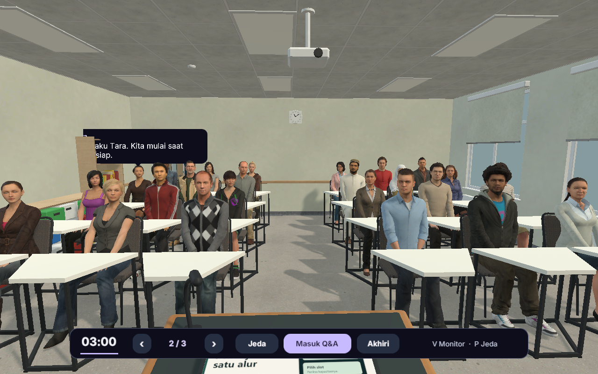

# NARA

NARA adalah ruang latihan presentasi untuk laptop dan headset XR. Pilih topik, presentasikan slide selama tiga menit, lalu beri giliran kepada audiens yang mengangkat tangan. Sesi diakhiri dengan satu saran untuk latihan berikutnya. Mode offline menyertakan contoh materi, pertanyaan, dan audio dalam bahasa Indonesia dan Inggris.

[Lihat pilihan IF 110 di player](docs/media/NARA-IF101.png) · [Tonton tanya jawab di kedua kelas](docs/media/NARA-gerak-audiens.mp4) · [Lihat pose audiens dari dekat](docs/media/NARA-pose-audiens.jpg) · [Lihat podium presentasi](docs/media/NARA-lectern.png)

## Struktur folder

- [`webxr/`](webxr/README.md) memuat versi browser dan panduan menjalankan latihan di laptop serta headset.
- `NARA/` memuat proyek yang dibuka di Unity Hub.
- `assets/blender/` memuat model sumber Blender.
- `docs/` memuat dokumentasi, gambar, dan video proyek.
- `tools/` memuat skrip build, impor materi, dan suara.
- `NARA/BuildFinalProject/` menampung rilis lokal. APK Quest berada di `Quest/NARA.apk`.

## Mulai di Unity

1. Clone repo ini dan buka folder `NARA/` di Unity Hub dengan **Unity 6000.3.28f1**.
2. Buka [scene NaraSeminar](NARA/Assets/FinalProject/Scenes/NaraSeminar.unity), lalu tekan **Play**.
3. Pilih **Kelas universitas** atau **IF 110** di bagian **Kelas**. Untuk latihan, pilih **Ruang 3D** atau **Layar laptop**. **Materi latihan** memuat ringkasan dan slide. **Pengaturan** memuat bahasa, suara, dan pencatatan waktu.
4. Untuk Windows, gunakan **NARA → Final Project → Build Windows**. Player hasil build berada di `NARA/BuildFinalProject/Windows/NARA.exe`.

Setelah player Windows selesai dibangun, buka [NARA Live.cmd](NARA%20Live.cmd) dan pilih **Materi latihan → Impor berkas** untuk memuat PowerPoint, PDF, atau gambar. Aktifkan **Suara live** di **Pengaturan**. GPT-6.1 Sol melalui AISUBS menyusun pertanyaan berdasarkan teks slide, penjelasan, dan jawaban. Kamu bisa memakai mikrofon atau mengetik. [Panduan impor dan suara live](docs/SUARA-KARAKTER.md#pertanyaan-live-di-windows)

Kedua kelas punya empat baris dan **24 NPC** dari 30 profil. IF 110 memakai kursi kayu dan layar PPT di dinding depan. Kelas universitas memakai meja trapesium dan kursi dari model Blender tim. NARA mengacak penghuni saat ruangan dibuka dan saat latihan diulang. Saat menyimak, tiap orang sesekali berubah posisi, menoleh ke slide, atau mengikuti teman yang mendapat giliran. Dua pertanyaan utama datang dari kursi berbeda.

Nama dan ucapan mengikuti pembicara. Di tepi atas layar, balon bisa pindah ke bawah wajah. Jika dinding menghalangi wajah atau pembicara keluar dari pandangan, ucapan muncul di panel percakapan. Kalimat panjang dibagi menjadi beberapa bagian yang berganti selama audio diputar. Saat giliran menjawab, klik panah di panel untuk membaca ulang. Di headset, gunakan **Y** dan **B**.

Audiens IF 110 memakai rekaman duduk di kursi. Di kelas universitas, gerakan mengikuti rekaman duduk di meja dan tinggi meja Blender di depan tiap orang. Klip Overte menambah variasi angkat tangan, bicara, dan menyimak. Penanya menahan tangan sampai pengguna menekan **Persilakan bertanya**. Setelah itu, penanya menurunkan tangan dan menggerakkan lengan sesuai bagian pertanyaannya.

Pilihan kelas, mode latihan, bahasa, suara, dan pencatatan waktu tersimpan otomatis di perangkat. Di headset, tekan **grip kiri** di menu persiapan untuk mengganti kelas dan lihat dinding depan untuk membaca PPT. Di Windows, pilih **Lihat PPT** atau tekan **V** di IF 110 untuk berganti antara layar dan audiens. Di kelas universitas, tahan **V** untuk melihat monitor podium. **Tab** dan **Shift+Tab** memindah fokus, **Enter** mengaktifkan kontrol, dan klik kanan lalu seret untuk melihat ruangan.

## Meta Quest

Setelah APK terpasang, buka **Pengaturan Quest** dengan grip kanan dari menu persiapan. Tekan **A** untuk menyimpan kunci AISUBS dan **B** untuk memilih materi yang tersimpan di headset. Kembali dengan **Y**, lalu aktifkan **Suara live** dengan **B**. Tahan grip kanan untuk bicara. Tekan pelatuk kanan untuk mengetik penjelasan atau jawaban.

NARA memproses mikrofon, suara NPC, dan impor materi di headset. Mode live memakai Wi-Fi untuk mengirim teks ke AISUBS dan meminta respons GPT-6.1 Sol. Android Keystore melindungi kunci yang dimasukkan di headset. PDF mempertahankan tampilan halaman. PPTX menampilkan teks dan gambar dengan tata letak dasar, sedangkan PPT lama menampilkan isi teks. PNG dan JPEG dapat dibaca dengan OCR lokal. Batas impor 32 MB dan 60 slide.

Untuk membangun APK gunakan Unity **6000.3.28f1** dengan Android Build Support, SDK/NDK, dan OpenJDK. Dari root repo, jalankan `python tools/nara_prepare_quest.py --help` untuk melihat argumen cache, `javac`, dan `android.jar`. Setelah dependensi selesai disiapkan, aktifkan platform Android dan pilih **NARA → Final Project → Build Quest APK**. Hasil build berada di `NARA/BuildFinalProject/Quest/NARA.apk` dan menargetkan Quest 2, Quest 3, dan Quest 3S melalui OpenXR.

Untuk mengemas ulang rilis Quest lokal dari hasil kompilasi yang tersimpan, jalankan `python .local/quest/assemble_quest.py` dengan Android SDK Build-Tools 36.1 dan JDK 25 terpasang. Folder `.local/quest/` juga menyimpan kunci penandatanganan rilis lokal dan dikecualikan dari Git.

## Lanjutkan proyek

- [HANDOFF.md](HANDOFF.md) memuat konteks sesi, keputusan pengguna, arsitektur, kontrol, alur build, dan status pengujian. File ini bisa diberikan langsung ke chat AI lain.
- [Model Blender kelas universitas](assets/blender/NARA-Kelas-Presentasi.blend), [model Blender IF 110](assets/blender/NARA-IF-101.blend), dan [model sumber meja dan kursi](assets/blender/Meja-Kursi.blend) tersedia untuk penyuntingan.
- [Sumber dan lisensi aset](docs/ASSETS.md) memuat sumber ruang, avatar, fon, audio, dan aset tim.
- [Naskah dan suara karakter](docs/SUARA-KARAKTER.md) menjelaskan audio offline, penggantian suara, dan pengaturan relay live.
