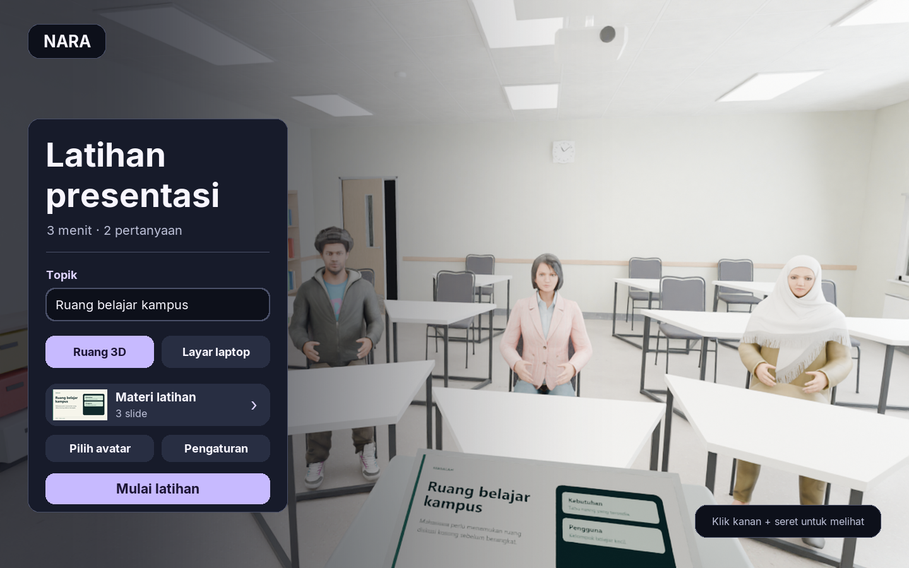

# NARA

NARA adalah ruang latihan presentasi untuk laptop dan headset XR. Pilih topik, presentasikan slide selama tiga menit, lalu beri giliran kepada audiens yang mengangkat tangan. Sesi diakhiri dengan satu saran untuk latihan berikutnya. Mode offline menyertakan contoh materi, pertanyaan, dan audio dalam bahasa Indonesia dan Inggris.

## Mulai di Unity

1. Clone repo ini dan buka folder `NARA/` di Unity Hub dengan **Unity 6000.3.28f1**.
2. Buka [scene NaraSeminar](NARA/Assets/FinalProject/Scenes/NaraSeminar.unity), lalu tekan **Play**.
3. Pilih **Ruang 3D** atau **Layar laptop**. **Materi latihan** memuat ringkasan dan slide. **Pengaturan** memuat bahasa, suara, dan pencatatan waktu.
4. Untuk Windows, gunakan **NARA → Final Project → Build Windows**. Player hasil build berada di `NARA/BuildFinalProject/Windows/NARA.exe`.

Sesi 3D memakai tiga kursi panel yang dapat diisi dari 24 pilihan avatar. **Tab** dan **Shift+Tab** memindah fokus. **Enter** mengaktifkan kontrol. Klik kanan dan seret untuk melihat ruangan. Tahan **V** untuk melihat monitor podium.

## Lanjutkan proyek

- [HANDOFF.md](HANDOFF.md) memuat konteks sesi, keputusan pengguna, arsitektur, kontrol, alur build, dan status pengujian. File ini bisa diberikan langsung ke chat AI lain.
- [Model Blender ruang](assets/blender/NARA-Kelas-Presentasi.blend) dan [model meja dan kursi](assets/blender/Meja-Kursi.blend) tersedia untuk penyuntingan.
- [Sumber dan lisensi aset](docs/ASSETS.md) memuat sumber ruang, avatar, fon, audio, dan aset tim.

Jalur Quest memakai Android ARM64 dan OpenXR. Modul Android Build Support, SDK/NDK, dan OpenJDK diperlukan untuk **Build Quest APK**. Verifikasi headset fisik masih perlu dilakukan.
